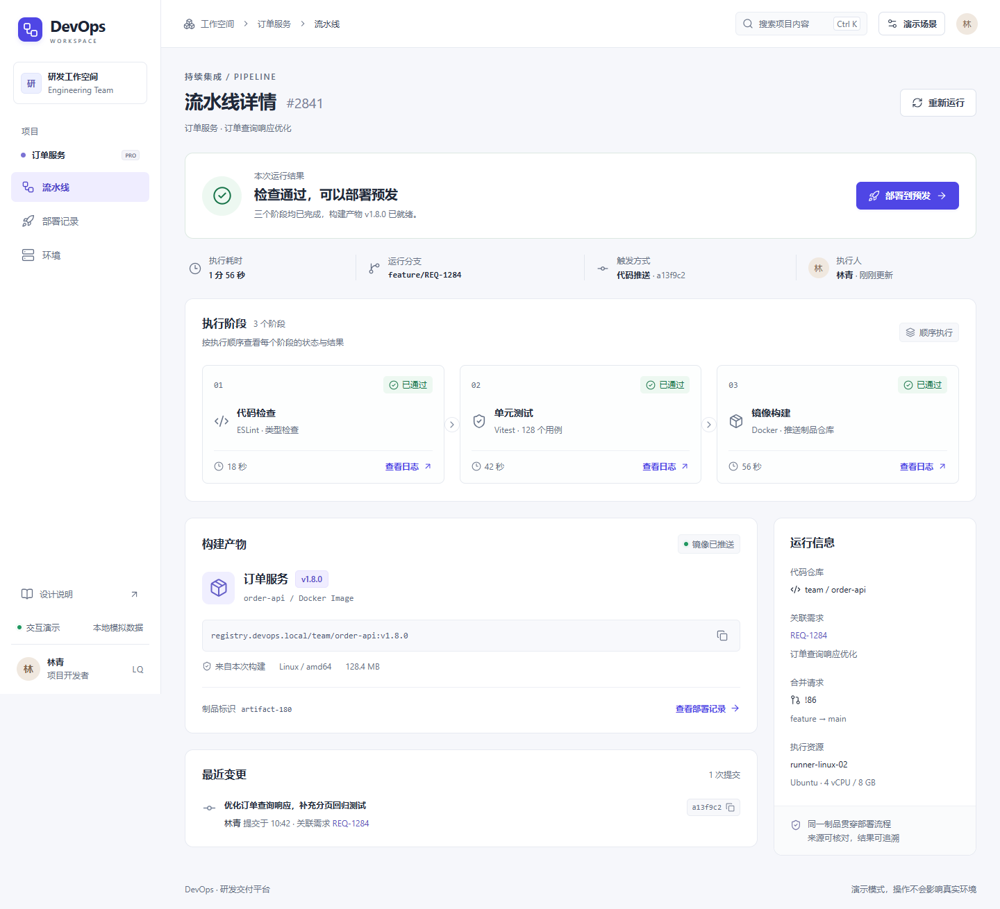
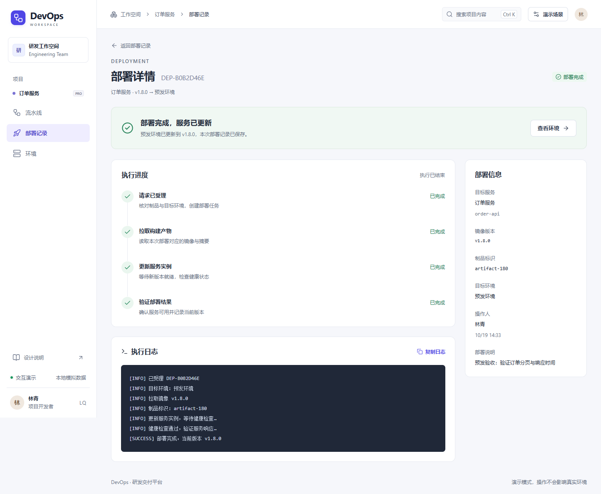
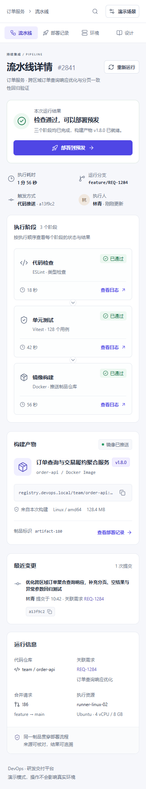
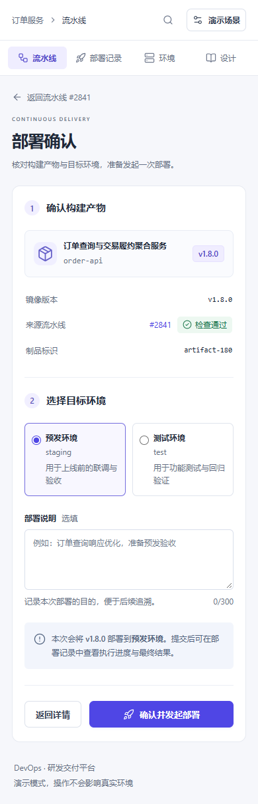

# DevOps Demo · 用 UI 设计方法改进 AI 开发的界面

AI 已经能快速生成页面，但信息如何排列、操作如何突出、失败后如何恢复，仍需要具体的设计判断。这个项目把这些判断放进一条可以实际操作的 DevOps 流程中。

这是 **《UI设计优化点：DevOps 平台界面开发实战》** 的配套演示。合集以 50 篇短教程讲解信息层级、布局、文字、颜色和组件状态，围绕同一套研发交付平台组织案例。本仓库提供演示代码、设计应用说明及配套 Skill 快照；教程正文另行发布。

**体验路径：流水线详情 → 部署确认 → 执行进度 → 部署结果。** 另有部署历史、环境总览和设计说明页面。可以切换失败、无权限、空记录和长内容，检查同一界面如何处理不同情况。

使用 Vue 3、TypeScript、Vite、Vue Router 和 Lucide 图标。页面由 Vue 单文件组件组成，具有路由、共享状态、表单校验与本地记录；`index.html` 是 Vite 的应用入口。

[配套 UI Skill 仓库](https://github.com/liyanyi7959/ui-design-refinement) · [设计方法与页面对应关系](docs/设计应用.md) · [验收记录](docs/验收记录.md)

## 项目截图

流水线详情将检查结论、当前可执行操作、阶段结果和构建产物分层呈现。顶部导航与桌面侧栏固定，页面内容独立滚动。



部署结果区分请求受理、执行中与最终成功；失败时提供原因与重新部署入口。



窄屏下重排内容，并用较长服务名称检查换行。下面是手机端的流水线与部署确认页面。

<table>
  <tr>
    <th>流水线详情 · 长内容</th>
    <th>部署确认 · 环境与说明</th>
  </tr>
  <tr>
    <td valign="top"></td>
    <td valign="top"></td>
  </tr>
</table>

截图来自本项目的实际浏览器渲染，数据与日志均为模拟。另见[滚动后的固定顶部](docs/screenshots/fixed-header.png)。

## UI 合集讲什么

| 主题 | 主要内容 | 在本项目中的体现 |
| --- | --- | --- |
| 任务与信息层级 | 先明确用户要完成的事，再安排内容和操作 | 先呈现检查结论与部署入口，再展示追溯信息 |
| 布局与空间 | 宽度、间距、固定区域与响应式重排 | 固定导航、弹性主区、字段分组、手机单列 |
| 文字排版 | 字号、字重、行高、行长与对齐 | 有限文字角色，长服务名与代码标识单独处理 |
| 颜色与层次 | 颜色职责、对比度、表面与阴影 | 主色强调操作；状态同时使用文字和图标 |
| 组件与状态 | 选择、反馈、空状态与真实控件语义 | 原生单选与对话框，区分无记录和筛选无结果 |

文章解释方法和适用条件，Skill 将它们整理成 AI 可以读取的工作指引，演示项目展示部分方法如何落实到界面。方法参考 Adam Wathan 与 Steve Schoger 的《Refactoring UI》，结合 DevOps 场景重新组织案例与工程约束；本仓库不包含原书 PDF。

## 启动

建议使用 Node.js 24.12 及以上版本，或符合 Vue 官方要求的 Node.js 22.18 及以上版本。

```sh
npm ci
npm run dev
```

打开终端显示的地址，默认是 <http://127.0.0.1:5173/>。5173 已占用时，先停止占用进程，或用 `npm run dev -- --port 5175` 指定其他端口。

```sh
npm test          # 部署状态、准入条件和本地数据校验
npm run build    # TypeScript 检查与生产构建
npm run preview  # 预览 dist 中的构建结果
```

生产文件位于 `dist/`。部署到静态服务器即可；相对资源路径与 Hash 路由支持子目录托管。请通过 HTTP 服务访问，不要直接双击 HTML 文件。

浏览器检查脚本使用 Playwright CLI，与应用依赖分开。保持开发服务运行，在项目目录的另一个终端中执行：

```sh
mkdir output
npx @playwright/cli -s=devops open http://127.0.0.1:5173/
npx @playwright/cli -s=devops run-code --filename scripts/check-browser.js
```

首次使用 CLI 时，根据提示安装浏览器。脚本固定访问 5173，会重置该地址中的演示记录，并把截图保存到 CLI 会话工作目录的 `output/`。请使用专门的演示会话运行。当前结果见 [验收记录](docs/验收记录.md)。

## 推荐体验顺序

1. 在流水线详情查看阶段状态、构建产物和阶段日志，点击「部署到预发」。
2. 在确认页选择环境，填写说明并提交；观察请求受理、执行中和最终结果。
3. 刷新页面，再查看部署历史和环境版本，记录仍然保留。
4. 打开右上角「演示场景」，切换检查失败、运行中、无权限、请求失败、部署失败、长内容或空记录。
5. 缩窄窗口，检查内容重排；使用 Tab、方向键和 Escape 操作表单及对话框。Windows 使用 Ctrl+K，macOS 使用 ⌘K 打开搜索。

场景开关立即作用于当前会话；刷新后恢复默认场景。已提交记录的目标环境、说明和预设结果会保留。点击「恢复默认数据」会替换本浏览器内的演示记录。

## 实现范围

这是使用本地模拟数据的前端演示，不连接 CI/CD、镜像仓库或 Kubernetes。部署进度按时间推进，刷新后依据记录中的开始时间恢复显示。失败任务保留失败状态，环境版本只读取成功记录。

权限开关用于展示交互限制；真实项目需要由服务端鉴权、校验制品、调度任务并返回执行状态。示例账号、日志、镜像地址与构建数据均为模拟内容。

记录保存在当前来源的 `localStorage` 中。不同浏览器、不同端口各自独立；清除站点数据会删除记录。存储不可用或损坏时，页面会说明原因。

## 项目结构

```text
src/
  components/       状态标签、图标、原生对话框、场景面板
  views/            各路由页面
  domain.ts         部署状态与数据规则
  store.ts          共享状态、本地持久化和模拟提交
  router.ts         Hash 路由
  styles.css        设计变量、组件样式与响应式布局
tests/              核心状态测试
scripts/            浏览器检查脚本
skills/             随项目附带的 UI Skill 与 50 项方法参考
docs/               设计对应关系及验收记录
```

## UI Skill 如何使用

本项目的 UI 判断依据是合集配套的 [ui-design-refinement](skills/ui-design-refinement/SKILL.md)。具体应用见 [设计应用](docs/设计应用.md)。Skill 文件随源码提供，不会自动安装到任何 AI 工具中。

继续修改时，可向 AI 提供：

```text
读取 skills/ui-design-refinement/SKILL.md 及相关参考段落。
运行当前 Vue 项目，查看真实页面后再调整。
保持流水线、制品、环境和部署记录之间的对应关系。
根据当前问题选择方法，检查失败反馈、长内容、键盘操作和窄屏布局。
报告实际修改和验证结果。
```

Skill 提供 UI 决策指引；Vue 编码、构建和浏览器验证仍需开发工具完成。不需要为了这个演示叠加其他 UI 设计 Skill，也不据此推断它可以替代所有工程能力。

版本与启动环境参考：[Vue 官方快速上手](https://vuejs.org/guide/quick-start.html)、[Vite 官方指南](https://vite.dev/guide/)、[Vue Router 路由模式](https://router.vuejs.org/guide/essentials/history-mode.html)。
